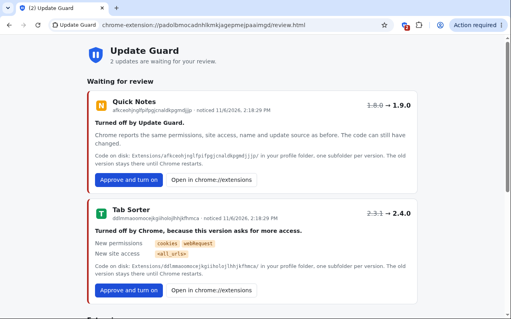
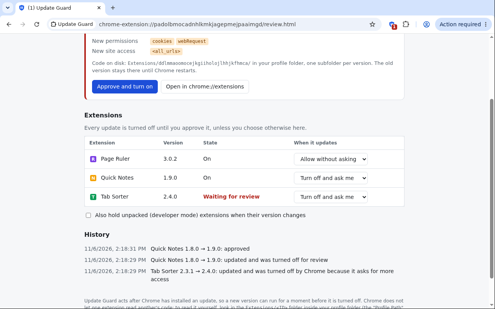

# Update Guard

A Chrome extension that turns other extensions off when they update, tells you, and keeps them off
until you have reviewed and approved the new version. The point is to stop a hijacked or sold
extension from running new code in your browser unnoticed.





## Install

1. Open `chrome://extensions` and turn on **Developer mode** (top right).
2. Click **Load unpacked** and choose the `extension/` folder in this project.
3. Pin the shield icon to the toolbar. Its red badge counts the updates waiting for review.

Keep Developer mode on. In testing, Chromium 156 turned an unpacked extension off as soon as it was
reloaded with Developer mode off. To run Update Guard without Developer mode it would have to be packed
and installed from the Chrome Web Store or by policy.

## What it does

- On first run it records the version of every installed extension as approved.
- When an extension's version changes, Update Guard turns the extension off, shows a notification and
  adds it to the review page (click the toolbar icon, or the notification).
- The review page shows the old and new version and what Chrome reports as changed: new or dropped
  permissions and site access, name, description, homepage and update source. From there you can
  **Approve and turn on**, or open the extension in `chrome://extensions` (to inspect or remove it
  yourself). Update Guard only ever turns extensions off and on — it never uninstalls or modifies them.
- An extension waiting for review stays off. If it is turned on some other way (the toggle in
  `chrome://extensions`, or Chrome's own "accept new permissions" prompt), Update Guard turns it off
  again and says so. Approve it on the review page instead.
- Updates that happen while the browser is closed, or while Update Guard itself is off, are caught the
  next time it starts.

Exceptions, all set on the review page:

- **Allow without asking**, per extension: its updates are approved automatically and only logged.
- **Unpacked (developer mode) extensions** are not held unless you tick the box for that. When the box
  is ticked they are held when the `version` in their manifest changes.
- Extensions installed by policy can't be turned off by another extension. Update Guard still notifies
  you and lists the update, marked "Still running".
- An extension that was already off when it updated is listed for review without a notification.
- Newly installed extensions are not held: you just chose that version.

## Limits

- **It reacts after the fact.** Chrome installs the update first and only then tells Update Guard, so
  the new version can run for a moment before it is turned off. The extension API has no way to block
  an update beforehand.
- **Tested in Chromium 156 only**, with a private update server standing in for the Chrome Web Store.
  Not yet run in Google Chrome or against a real Web Store update.
- **It can't read the new code.** Chrome doesn't let one extension read another's files, so the review
  page shows metadata only. The code is in the `Extensions/<ID>/` folder inside your profile folder
  ("Profile Path" on `chrome://version`), one subfolder per version, e.g. `1.1.0_0`. In Chromium 156 the
  old version's folder stayed next to the new one until shortly after the next browser restart, so
  compare the two (`diff -r`) before you restart.
- **It only looks at the version number.** Changes to an extension's files that leave the version alone
  (for example by other software on the computer) are not noticed.
- Themes are ignored: they contain no code.

## Security surface

Update Guard holds `management`, `storage` and `notifications` only — no host permissions, no `tabs`,
no content scripts, no network use. It therefore cannot read or change web pages, cookies, keystrokes
or history on its own. The data it keeps (installed-extension names and versions, settings, a short
log) stays in local extension storage.

`management` is irreducible: turning other extensions off and on *is* the product, and the API is
monolithic (there is no "manage but only disable" scope). So a compromised version of Update Guard
could, in principle, silently disable other extensions — including a user's other security or privacy
extensions — which is the main reason to keep every other part of the surface minimal:

- The uninstall path was removed (v1.0.0): the UI only ever disables and re-enables, never
  `management.uninstall`. Removal is left to the user in `chrome://extensions`.
- No notification opens a URL on click; clicking only opens the extension's own review page.

These shrink what a malicious update could do through the extension's own code, but they do not change
the `management` capability itself. No extension can guard its own update channel, so Update Guard
explicitly does not watch itself.

## Files

| Path | What it is |
|---|---|
| `extension/manifest.json` | Manifest (MV3). Permissions: `management`, `storage`, `notifications`. |
| `extension/background.js` | Service worker: compares versions, turns extensions off, notifies. |
| `extension/review.html`, `review.js`, `review.css` | The review page (also the options page). |
| `extension/shared.js` | State layout and the comparison of two versions, used by both. |
| `extension/icons/` | `icon.svg` is the source for the 16, 32 and 48 px icons. `icon128.png` comes from `store/icon-store.svg`, which has the padding the Web Store asks for. Render with `rsvg-convert -w N -h N in.svg -o out.png`. |
| `test/e2e.py` | End-to-end test with an unpacked test extension. |
| `test/e2e_crx_update.py` | End-to-end test with real packed-extension updates from a local update server. |
| `dist/update-guard-1.0.0.zip` | The package to upload to the Chrome Web Store. |
| `store/listing.md` | Everything the Web Store dashboard asks for, ready to paste, and how to rebuild the ZIP. |
| `store/screenshots/`, `store/promo-small-440x280.png` | Listing images. `store/make_screenshots.py` regenerates the screenshots. |
| `store/privacy-policy.md` | Privacy statement, in case the store asks for a URL. |

## Tests

Both tests drive a real Chromium through Selenium. They need the Debian packages `chromium`,
`chromium-driver`, `python3-selenium` and `xvfb`. (Google Chrome no longer accepts `--load-extension`,
which is why they use Chromium.)

```bash
xvfb-run -a python3 test/e2e.py             # optional argument: a folder for screenshots
xvfb-run -a python3 test/e2e_crx_update.py
```

`e2e_crx_update.py` needs `sudo`: it writes a Chromium policy file
(`/etc/chromium/policies/managed/update-guard-test.json`) so that Chromium installs the test extension
from the local update server, and removes it when it finishes. Google Chrome reads a different policy
folder and is not affected.

## License

[MIT](LICENSE) © Kevin Boergens
